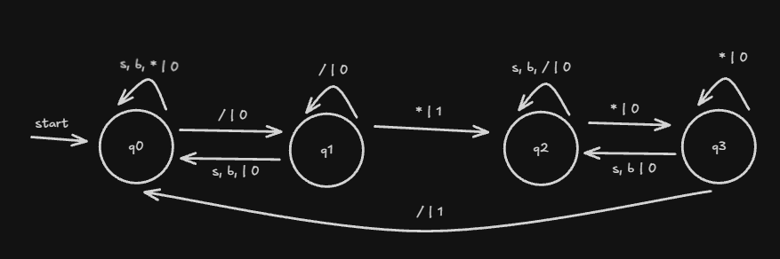
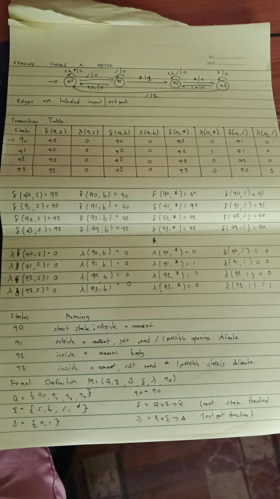

# Mealy Machine for C-Style Comments

**Shanine Claire A. Besto**
**3 BSCS-A**
**CS 13a — Automata Theory and Formal Language**

A C implementation of a Mealy machine, a finite automaton with output, that watches for C-style comments. The input alphabet is `{s, b, *, /}`, where `s` and `b` are ordinary characters — that is, anything that is not `*` or `/`. The output alphabet is `{0, 1}`.

In a Mealy machine the output is attached to the **transition**, so every move emits exactly one output symbol. The machine outputs `1` on the move that begins a comment (the `*` that follows an opening `/`) and on the move that ends it (the `/` that follows a closing `*`). Every other move outputs `0`.

Unlike a DFA or an NFA, a Mealy machine has no final states, so a string is never accepted or rejected. The result of a run is the output string. There is also no trap state, because every state has a move for every symbol.

## States

| State | Meaning |
|-------|---------|
| q0 | start state; outside a comment |
| q1 | outside a comment, just read `/` (possible opening delimiter) |
| q2 | inside a comment body |
| q3 | inside a comment, just read `*` (possible closing delimiter) |

## Formal Definition

```
M = (Q, Σ, Δ, δ, λ, q0)

Q  = { q0, q1, q2, q3 }
Σ  = { s, b, *, / }
Δ  = { 0, 1 }
q0 = q0
δ  : Q × Σ → Q        (next-state function)
λ  : Q × Σ → Δ        (output function, attached to the transition)
```

## State Diagram



Edges are labeled `input | output`.

## Transition Table

| State | δ(q,s) | λ(q,s) | δ(q,b) | λ(q,b) | δ(q,*) | λ(q,*) | δ(q,/) | λ(q,/) |
|-------|--------|--------|--------|--------|--------|--------|--------|--------|
| → q0 | q0 | 0 | q0 | 0 | q0 | 0 | q1 | 0 |
| q1 | q0 | 0 | q0 | 0 | q2 | 1 | q1 | 0 |
| q2 | q2 | 0 | q2 | 0 | q3 | 0 | q2 | 0 |
| q3 | q2 | 0 | q2 | 0 | q3 | 0 | q0 | 1 |

`→` marks the start state. Each pair of columns gives the next state, then the output emitted on that move.

## δ and λ Equations

```
δ(q0,s)=q0   δ(q0,b)=q0   δ(q0,*)=q0   δ(q0,/)=q1
δ(q1,s)=q0   δ(q1,b)=q0   δ(q1,*)=q2   δ(q1,/)=q1
δ(q2,s)=q2   δ(q2,b)=q2   δ(q2,*)=q3   δ(q2,/)=q2
δ(q3,s)=q2   δ(q3,b)=q2   δ(q3,*)=q3   δ(q3,/)=q0

λ(q0,s)=0    λ(q0,b)=0    λ(q0,*)=0    λ(q0,/)=0
λ(q1,s)=0    λ(q1,b)=0    λ(q1,*)=1    λ(q1,/)=0
λ(q2,s)=0    λ(q2,b)=0    λ(q2,*)=0    λ(q2,/)=0
λ(q3,s)=0    λ(q3,b)=0    λ(q3,*)=0    λ(q3,/)=1
```

## Sample Strings

| Input | Output string | Final state |
|-------|---------------|-------------|
| `/*s*/` | `01001` | q0 |
| `/*b*/` | `01001` | q0 |
| `/**/` | `0101` | q0 |
| `/***/` | `01001` | q0 |
| `/*sbs*bsb*/` | `01000000001` | q0 |
| `/*s/b*/` | `0100001` | q0 |
| `/**/s/*bb*/` | `01010010001` | q0 |
| `sbs/**/bs` | `000010100` | q0 |
| `/**` | `010` | q3 |
| `/*/` | `010` | q2 |
| `/**b/` | `01000` | q2 |
| `//bb` | `0000` | q0 |

A final state of q0 means the string ends outside a comment. A final state of q2 or q3 means a comment was opened but never closed.

## Handwritten

<!-- Upload your handwritten work and replace the file names below -->

